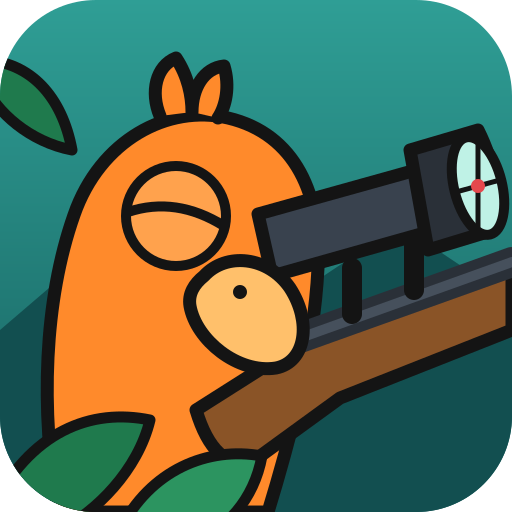
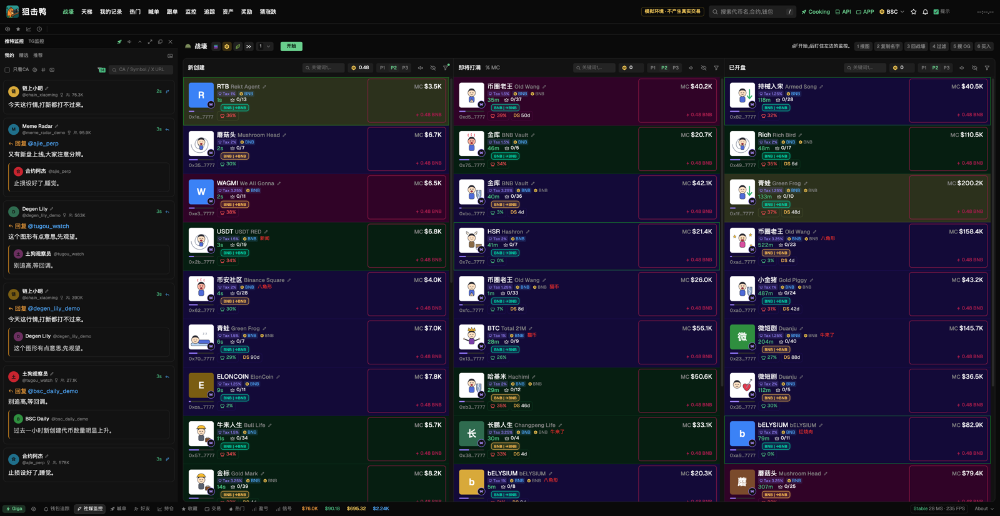

<p align="center">
  
</p>

<h1 align="center">狙击鸭</h1>

<p align="center">练习 meme 买入速度的网页小游戏。推文一出现就开始计时，谁最快点中第一个币，谁就是天梯第一。</p>



> 这是模拟环境，不连接钱包，不发送任何链上交易。界面里的代币、市值和推文都是模拟数据，大号账号的模拟推文只配图、不含任何发言。本项目与 GMGN、Google 及其他任何平台或人物无关。

## 快速开始

需要 Node.js 24 或更高版本，没有第三方依赖。

```bash
git clone https://github.com/bnbxcs/sniper-duck.git
cd sniper-duck
npm start
```

打开 <http://127.0.0.1:8899>，取个昵称，点战壕栏的「开始」。

```bash
npm test
```

| 环境变量 | 默认值 | 作用 |
| --- | --- | --- |
| `PORT` | `8899` | 监听端口 |
| `HOST` | `127.0.0.1` | 监听地址；要让局域网或公网访问时设成 `0.0.0.0` |
| `DB_PATH` | `data/trainer.db` | SQLite 数据库位置 |

## 玩法

点「开始」后等 3 到 20 秒。目标推文出现时开始计时，点中第一个币时结束。CZ 和何一的帖子是深红高亮，并有提示音。

| 步骤 | 操作 | 判定 |
| --- | --- | --- |
| 1 搜图 | 悬停推文图片，点右上角放大镜 | 必须是目标推文 |
| 2 复制名字 | 在搜图页选中名字（可双击），按 Cmd+C | 复制的文字必须正好是名字 |
| 3 回战壕 | 按 Esc 或关闭搜图标签页 | 复制完成后才算 |
| 4 过滤 | 把名字粘贴到「新创建」的关键词框，或用筛选窗 | 关键词必须正确 |
| 5 搜 OG | 按 `/` 粘贴名字，看到老币后按 Esc | 看到结果并关闭才算 |
| 6 买入 | 点最早出现的同名币右侧的买入区 | 买到后来的同名币或其他币，本局失败 |

- 步骤 4 和 5 顺序不限，其余步骤必须按顺序完成。
- 步骤没做完时点买入只会提示，计时继续。
- 后出现的币会排在上面，把第一个币挤下去，点之前要看准。
- 鼠标停在「新创建」栏内时这一栏暂停刷新，标题栏显示橙色暂停图标，移开后恢复。栏内没有币时不暂停，第一个币照常出现。

## 天梯

| 榜单 | 排名依据 |
| --- | --- |
| 总榜 | 每人历史最快一局 |
| 今日、本周 | 每人在该周期内最快一局，按北京时间划分 |
| 稳定榜 | 最近 10 局成功局的平均用时，不足 10 局不上榜 |

买错和超时只进个人记录。操作数据不合理的成绩进入「待审核」，不上榜。点开天梯的任意一行，都能看到那一局的完整操作记录。

## 分享成绩

打出有效成绩后，结算窗可以把成绩分享到推特。成绩图片会先复制到剪贴板，再打开发帖页，文字和仓库链接已经填好，在发帖框按 Cmd+V 粘贴图片即可。复制失败时图片会自动下载。也可以用「保存图片」单独下载。

## 防作弊

网页游戏无法完全挡住脚本，这里的目标是让作弊费力且可以复查：

- 答案按步骤下发：开局只给图片，搜图才给名字，过滤正确才给币。
- 服务器记录每一步的收到时间，和客户端时间差太多就判待审核。
- 校验步骤顺序、最短耗时、买入是否早于上币时间、是否有鼠标轨迹。
- 每局保存完整操作记录和压缩后的鼠标轨迹。

## 用自己的图片出题

内置 20 道题在 `scenarios/scenarios.json`，图片是原创的，由 `npm run images` 生成。

要加自己的题，把图片和同名描述放进 `data/local-scenarios/`，重启后生效。这个目录不会提交到 git。

```json
{
  "imageFile": "my-meme.png",
  "name": "名字",
  "pinyin": "míng zi",
  "en": "English name",
  "altEn": ["Another title", "One more"],
  "meaning": "这个梗的含义。",
  "visual": "图片上画了什么。",
  "nearNames": ["相近名一", "相近名二", "相近名三"]
}
```

`nearNames` 里的名字不能包含正确名字，否则它们会通过过滤。

## 目录

```text
server/      HTTP、判定规则（game.js）、排行榜和 SQLite（db.js）
public/      战壕、监控、搜图页、结算页、天梯页
scenarios/   内置题库和原创图片
data/        数据库和你的本地图片，不提交
docs/        README 用的截图
test/        判定规则和接口测试
```

## 更新记录

| 日期 | 内容 |
| --- | --- |
| 2026-11-07 | 结算后可以把成绩图片分享到推特 |
| 2026-11-07 | 项目命名为狙击鸭，加入方形 Logo |
| 2026-11-07 | CZ 和何一的帖子加入提示音和深红高亮；战壕栏加入开始按钮 |
| 2026-11-07 | 界面按真实页面测量的尺寸和配色重做 |
| 2026-11-07 | 第一版：全流程计时、服务器判定、操作记录和天梯 |

完整改动见 `git log`。

## 致谢

界面字体是 [Geist](https://github.com/vercel/geist-font)，按 SIL Open Font License 随仓库分发，许可证见 `public/fonts/LICENSE.txt`。
